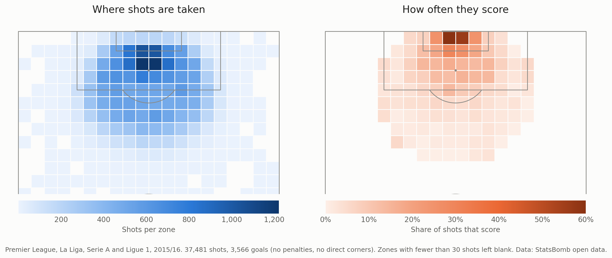

# football-ai

[](https://github.com/PaulGuignard/football-ai/actions/workflows/ci.yml)

**Who really creates danger on a football pitch?** Goals and assists only
reward the last touch. This project gives a value to every pass, carry and
dribble according to how much it raises the chances of scoring and then
uses those values to evaluate players beyond the usual stats.

**Status.** Work in progress. The data pipeline, the exploration and two
expected goals (xG) models are done and every experiment is tracked in
MLflow. The players' positions come next.



*The left map shows where the 37,481 shots of the four leagues were taken
from and the right one shows how often each zone scores. Goals come from a
much smaller area than shots.*

## What's done so far

- **Data.** StatsBomb open data for four complete 2015/16 seasons of the
  Premier League, La Liga, Serie A and Ligue 1. That makes 1,517 matches and
  5.3 million events loaded into a DuckDB database by an idempotent
  pipeline that can be stopped and re-run without creating duplicates.
- **Exploration in SQL.** 37,481 shots studied in `sql/explore/` with a few
  findings along the way.
  - Only 1 shot in 10 ends up in the net.
  - Headers seem to score more than foot shots overall but less at every
    distance where they are taken up to 18 yards. It is a case of Simpson's
    paradox with distance as the confounder.
  - The shot angle adds information that distance alone doesn't give.
  - Shots from counter-attacks score 15.5% of the time against about 10% for
    the others even though they are taken from about the same distance.
- **First xG models.** A logistic regression and gradient boosting built on
  eight simple inputs and tested on 304 matches they never saw in training.

  | | Log loss ↓ | AUC ↑ |
  |---|---|---|
  | Naive baseline (same xG for every shot) | 0.317 | 0.500 |
  | Logistic regression | 0.264 | 0.788 |
  | Gradient boosting, default settings | 0.263 | 0.791 |
  | **Gradient boosting, tuned** | **0.261** | **0.796** |
  | StatsBomb xG (professional model) | 0.250 | 0.818 |

  The logistic regression closes about 80% of the gap between the baseline
  and StatsBomb and its probabilities are well calibrated. Its coefficients
  confirm that pressure lowers the chances once distance is accounted for.
  They also hold one surprise because direct free kicks score 2 to 4 times
  more than open-play shots taken from the same distance.
  Gradient boosting tuned by cross-validation on whole matches does better
  on almost every fold but by too little to matter. The gain is about 0.001
  of log loss. With these inputs the limit is the data and not the model.
- **Experiment tracking with MLflow.** Every run keeps its settings, its
  scores and the trained model. Settings are chosen by cross-validation and
  the test set is only used once.

Every step, decision and result is written up in the
[project log](docs/project_log.md).

## Roadmap

1. ~~**Expected goals (xG) model** giving the probability that a shot
   becomes a goal with a logistic regression and then gradient boosting.~~
   Done.
2. ~~**Experiment tracking** with MLflow and tuning by cross-validation.~~
   Done.
3. **xG with the players' positions** to know where the keeper and the
   defenders stand when the shot is taken. Inputs built by hand and fed to
   gradient boosting will be compared with the raw positions fed to a
   neural network in PyTorch.
4. **Demo.** An app where you place a shot on a pitch and get its xG back
   from an API built with FastAPI and Docker.
5. **Action values.** The chance of scoring before and after each action.
   It is learnt from sequences of play with a small transformer.
6. **AI agent.** Ask questions about players in plain language. The agent
   queries the database, calls the models and searches football texts with
   RAG.

## Stack

Python, SQL (DuckDB), pandas, scikit-learn, MLflow, matplotlib / mplsoccer, pytest,
GitHub Actions, uv and Git.
Coming next are PyTorch, FastAPI, Docker and an LLM agent with RAG.

## Project structure

```
src/football_ai/    reusable code: features table, xG models, MLflow tracking
tests/              pytest tests, run on every pull request
scripts/            data loading, exploration, training and evaluation
sql/schema.sql      database schema
sql/features/       the table the models learn from
sql/explore/        exploration queries
docs/               project log and figures
```

## Run it

Requires [uv](https://docs.astral.sh/uv/).

```bash
uv sync                                     # install the environment
uv run python scripts/04_load_events.py     # load the data (~25 min)
uv run python -m football_ai.features       # build the features table
uv run python scripts/07_evaluate_xg.py     # train and compare the xG models
uv run python scripts/10_tune_boosting.py   # tune the boosting, log runs in MLflow
uv run mlflow ui --backend-store-uri sqlite:///mlflow.db   # browse the runs
uv run pytest                               # run the tests
```

## Data

Data provided by [StatsBomb](https://statsbomb.com) through its
[open data](https://github.com/statsbomb/open-data) repository. The 2015/16
seasons are used to show the method and the same pipeline could run on more
recent data.