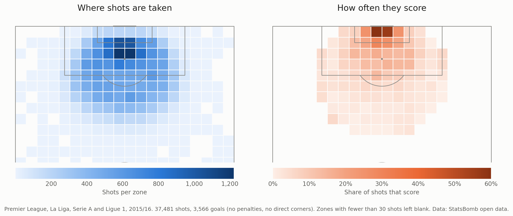

# football-ai

**Who really creates danger on a football pitch?** Goals and assists only
reward the last touch. This project gives a value to every on-ball action
(pass, carry, dribble) according to how much it raises the chances of
scoring, then uses those values to evaluate players beyond the usual stats.

**Status:** work in progress. The data pipeline and the exploration are
done; the first model (expected goals) is being built.



*Left: where the 37,481 shots of the four leagues were taken from. Right:
how often each zone scores. Goals come from a much smaller area than shots.*

## What's done so far

- **Data**: StatsBomb open data, four complete 2015/16 seasons (Premier
  League, La Liga, Serie A, Ligue 1): 1,517 matches, 5.3 million events,
  loaded into a DuckDB database by an idempotent pipeline (it can be stopped
  and re-run without duplicates).
- **Exploration in SQL** (`sql/explore/`): 37,481 shots studied. A few
  findings:
  - only 1 shot in 10 ends up in the net;
  - headers seem to score more than foot shots overall, but less at every
    distance band where they are taken (up to 18 yards): a case of
    Simpson's paradox, distance being the confounder;
  - the shot angle adds information that distance alone doesn't;
  - shots from counter-attacks score more often (15.5% vs about 10%), from
    about the same average distance.

Every step, decision and result is written up in the
[project log](docs/project_log.md).

## Roadmap

1. **Expected goals (xG) model**, the probability that a shot becomes a
   goal: logistic regression as a baseline, then
   gradient boosting and a small neural network in PyTorch, compared with
   StatsBomb's own xG. Tests, CI and experiment tracking (MLflow).
2. **Demo**: an app where you place a shot on a pitch and get its xG, served
   by an API (FastAPI, Docker).
3. **Action values**: the chance of scoring before and after each action,
   learnt from sequences of play with a small transformer.
4. **AI agent**: ask questions about players in plain language; the agent
   queries the database, calls the models and searches football texts (RAG).

## Stack

Python, SQL (DuckDB), pandas, matplotlib / mplsoccer, uv, Git.
Coming next: scikit-learn, PyTorch, MLflow, pytest, GitHub Actions, FastAPI,
Docker, an LLM agent with RAG.

## Project structure

```
scripts/        data loading, exploration scripts, figures
sql/schema.sql  database schema
sql/explore/    exploration queries
docs/           project log and figures
```

## Run it

Requires [uv](https://docs.astral.sh/uv/).

```bash
uv sync                                    # install the environment
uv run python scripts/04_load_events.py    # load the data (~25 min)
uv run python scripts/run_sql.py sql/explore/01_shots_overview.sql
```

## Data

Data provided by [StatsBomb](https://statsbomb.com) through its
[open data](https://github.com/statsbomb/open-data) repository. The 2015/16
seasons are used to demonstrate the method; the same pipeline could run on
recent data.