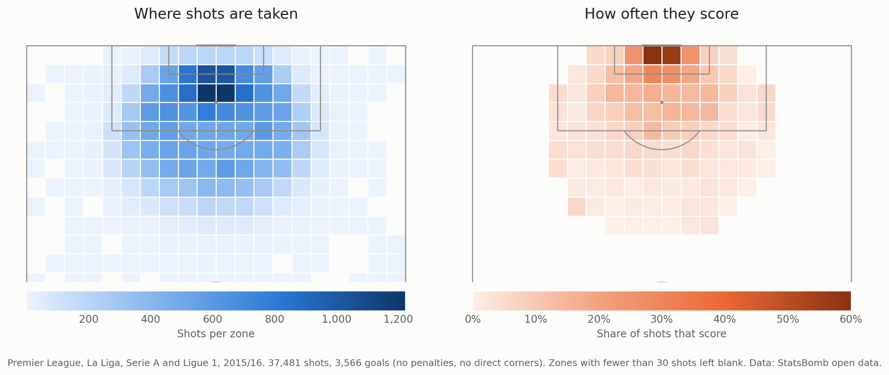
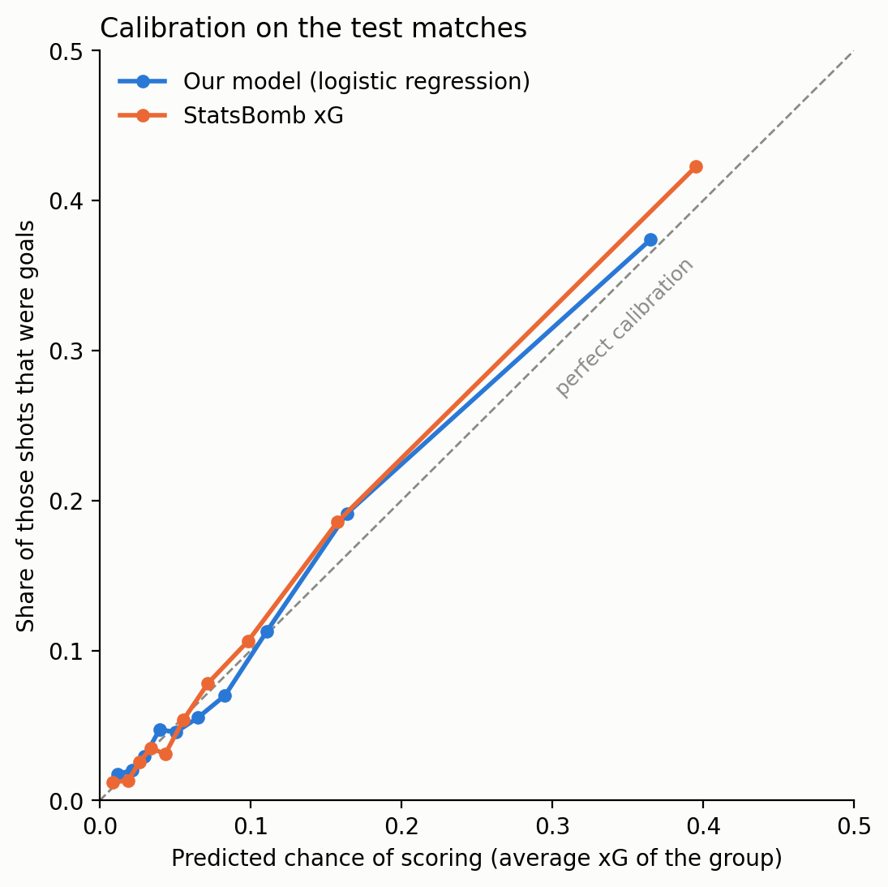
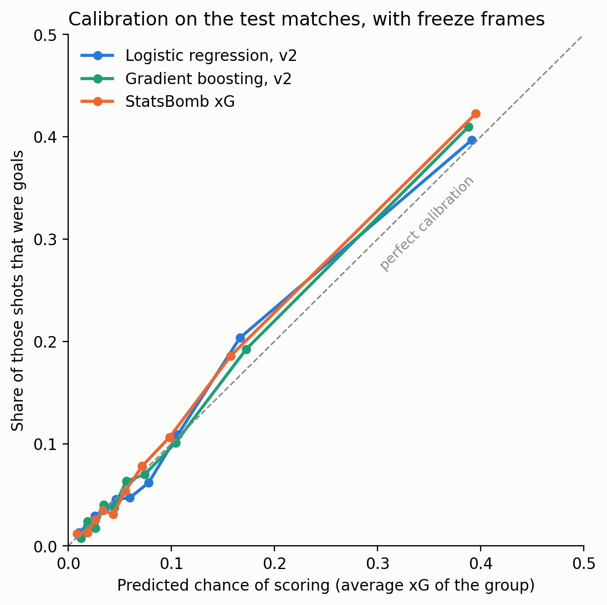

# Project log

Notes on how the project is going. They cover the questions I ask myself,
what I tried, what I found and the decisions that came out of it. Newest
entries are at the bottom.

## Why this project

Goals and assists only reward the last touch. The pass that breaks a line
three actions before a goal shows up nowhere in the usual stats. The question
behind this project is simple. **Who really creates danger on a football
pitch?**

The idea is to give every pass, carry and dribble a value that says how much
it changes the chances of scoring in the next few moments. Adding up those
values per player gives a way to evaluate players beyond goals and assists,
the way a scouting department would, by finding who creates danger without
it showing up in the usual stats. The same values can also be looked at by
team, by zone or by type of action. Then an assistant can answer questions
about players and teams using these values.

The plan goes step by step.

1. **An expected goals (xG) model** giving the probability that a shot ends
   up in the net. There are a few reasons to start there when the goal is to
   value every action.
   - It's the simplest version of the main question about how likely a goal
     is, because the shot is the last link of every attack.
   - It's a building block for what follows. Goals are rare with about 2.5
     per match among around 3,500 events, and valuing actions from goals
     alone would be very noisy. xG says how dangerous each shot was even when
     it missed.
   - It lets me build the whole chain of features, training, evaluation,
     tests and deployment on 37,000 shots before moving to 5 million events.
   - StatsBomb publishes its own xG so there is a reference to check my
     model against, which doesn't really exist for action values.
2. **Action values.** The idea is to estimate the chances of scoring before
   and after each action and to take the difference as the value of the
   action. A small transformer will read the last actions to judge the
   current one.
3. **An AI agent**, meaning a language model that decides by itself which
   tool to use to answer a question. It will have three tools, which are SQL
   queries on the database, the models above served through an API and a RAG
   search over football texts such as event definitions and match reports.
   That last one lets it explain and quote its sources instead of making
   things up.

It's also my way of practising deep learning, generative AI, SQL and MLOps on
a real problem rather than on toy examples.

**About the data.** The free StatsBomb data used here is from 2015/16, so
this is a demonstration of the method and not a scouting tool for today's
players. The loading step is kept separate from everything else so the same
models could run on recent data. It would only take plugging in another
season of StatsBomb data or writing a new loader for another provider, then
retraining.

---

## Choosing the data (27/10)

StatsBomb open data lists 80 competition-seasons but a listed season is not
necessarily a complete one. Counting matches and teams per season with
`scripts/02_count_matchs.py` showed two kinds of seasons.

| Season | Matches | Teams | |
|---|---|---|---|
| Premier League, La Liga, Serie A 2015/16 | 380 | 20 | complete |
| Ligue 1 2015/16 | 377 | 20 | 3 matches missing |
| Bundesliga 2015/16 | 34 | 18 | partial |
| La Liga 2020/21, Ligue 1 2022/23, Bundesliga 2023/24 | 32 to 35 | 18 to 20 | partial |

The team count is misleading here. 34 matches with 18 teams is exactly one
team's season against 17 opponents home and away. These partial seasons only
follow one club and usually a strong one. A model trained on them would
learn how that club plays rather than how a league plays.

**Decision.** Train on the four complete 2015/16 seasons, which make 1,517
matches. World Cups and Euros are complete too but I keep them aside for now.

## How the model will be evaluated (27/10, plan)

- The main test set is made of 2015/16 club matches that the model never
  sees during training. It is split **by match** rather than by shot so that
  shots from the same game can't end up on both sides.
- A second test on World Cups and Euros could show whether the model still
  works on national teams. Its limit is that it changes two things at once,
  clubs against national teams and 2015/16 against 2018-2024. A drop in
  performance couldn't be put down to one of them.

## A first look at a match (27/10)

One match, Chelsea 2-0 Arsenal in September 2015, is 3,732 events and 90
columns. A few things are worth knowing before going further.

- Passes, ball receipts and carries make up about 3/4 of the events. There
  were only 33 shots.
- Some events like `Starting XI` or `Half Start` are not actions at all and
  have no player and no location. They will have to be filtered out.
- One of the two goals was an own goal, which is not a shot. Goals in a match
  are not always shots.
- Coordinates are given from the point of view of the team making the action,
  which always attacks towards x = 120. Comparing both teams in the same
  sequence means flipping one of them so that (x, y) becomes (120 - x, 80 - y).

## Loading everything into DuckDB (28/10)

About 5 million events is too much to keep comfortably in pandas on a laptop
so the four seasons go into a DuckDB database, which is a single file with no
server. `scripts/04_load_events.py` downloads each match, cleans it and
inserts it.

- Only 39 of the ~90 columns are kept and they are listed in
  `sql/schema.sql`. I kept the context needed to rebuild sequences of play
  (match, period, time, possession, team, player and location) and the
  details of the actions the project is about, which are passes, carries,
  dribbles and shots. I left out the details of duels, fouls, cards,
  substitutions and goalkeeper actions because they don't say how dangerous
  an action is. Tactics and shot freeze frames were left out too because they
  are nested structures. Freeze frames show where every player stands when a
  shot is taken and could improve the xG model later. Adding a column only
  means re-running the loading script.
- Missing text has to become `NULL` and not the string `"nan"`.
- StatsBomb only fills flags like `under_pressure` when they are true so an
  empty cell means `False`.
- Matches already in the database are skipped so the script can be stopped
  and run again without duplicates. Each match is inserted in one go and is
  never half loaded.

A full run takes about 25 minutes for 1,517 matches and 5,321,459 events.

## First SQL look at shots (29/10)

From now on queries live in `.sql` files under `sql/explore/` so they can be
read directly on GitHub. `scripts/run_sql.py` runs a file and prints each
result as a table, with the comment above the query as its title.

`sql/explore/01_shots_overview.sql`

- 37,888 shots, about 25 per match.
- 3,869 goals, which means **10.2%** of shots end up in the net.
- The other outcomes are off target 33%, blocked 25%, saved 23%, wayward 6%
  and post 2%.

Here is what it means for the xG model, which is step 1 of the plan.

- The target is goal or no goal and the classes are imbalanced with 10%
  goals. A model always answering "no goal" would be right 90% of the time
  and still be useless so accuracy is not the right metric. I'll use log
  loss, the Brier score and calibration instead.
- The first baseline gives every shot an xG of 0.10. Any real model has to do
  clearly better than that.

Two questions are left open for the next step.

- Penalties are counted as shots and they go in far more often. Should they
  be part of the model?
- Do the match scores match the goals from shots plus own goals?

## Shot types, body parts and a data check (29/10)

`sql/explore/02_shot_types_and_scores.sql`

In all the tables below **conversion** means goals divided by shots, the
share of shots that end up as goals.

| Shot type | Shots | Goals | Conversion |
|---|---|---|---|
| Open play | 35,732 | 3,453 | 9.7% |
| Direct free kick | 1,749 | 113 | 6.5% |
| Penalty | 400 | 300 | 75.0% |
| Direct from a corner | 7 | 3 | 42.9% |

- Penalties go in 3 times out of 4. It's always the same situation at 11 m
  facing the keeper. There's nothing for a model to learn from their position
  and they would blur what it learns from other shots.
  **Decision.** Penalties are left out of training and get a fixed xG of
  0.75.
- "Corner" here means a shot taken straight from the corner flag and not a
  shot after a corner, which counts as open play with
  `play_pattern = 'From Corner'`. There are only 7 of them and a model can't
  learn anything from 7 examples so I leave them out too. Free kicks stay
  because 1,749 shots is enough and the shot type will be one of the model's
  inputs.
- That leaves 37,481 shots to train the xG model.

Without penalties the conversion is 9.4% for the right foot, 8.9% for the
left foot and **10.7% for the head**. I expected feet to do better. My guess
is that headers are almost always taken close to goal while foot shots
include lots of long-range attempts. If that's right, distance is a
confounder because it drives both the body part used and the chance of
scoring. At equal distance headers should then actually do worse. The next
step is to check it.

As a data check, goals from shots (3,869) plus own goals (128) add up exactly
to the final scores of all 1,517 matches.

## Distance, and why headers looked better than they are (29/10)

`sql/explore/03_shot_distance.sql`

Distance is measured from the shot to the centre of the goal in StatsBomb
units, which are roughly yards. Penalties and shots straight from a corner
are left out, which leaves the 37,481 shots of the model. The seven distance
bands add up to exactly that.

| Distance (yards) | Shots | Conversion |
|---|---|---|
| 0-6 | 1,022 | 44.7% |
| 6-12 | 7,624 | 17.7% |
| 12-18 | 8,398 | 12.0% |
| 18-24 | 8,220 | 5.5% |
| 24-30 | 7,721 | 2.9% |
| 30-36 | 3,569 | 1.6% |
| 36+ | 927 | 1.7% |

The chance of scoring drops very fast in the first yards and then flattens
out around 2%. The relationship is clearly not a straight line, which matters
for the model because a logistic regression on raw distance may struggle
with it.

Headers are taken from about 10 yards on average and foot shots from about
21. And at the same distance feet win every time.

| Distance (yards) | Headers | Head conversion | Foot shots | Foot conversion |
|---|---|---|---|---|
| 0-6 | 498 | 32.7% | 494 | 56.1% |
| 6-12 | 4,169 | 10.6% | 3,410 | 26.5% |
| 12-18 | 1,392 | 3.5% | 6,997 | 13.7% |

So the guess was right. Overall a header goes in more often than a foot shot,
10.7% against about 9%. But in each distance band up to 18 yards a header
goes in 1.7 to 4 times less often than a foot shot and there are almost no
headers from further out. Headers only looked better because they are taken
much closer to goal. This is a textbook case of Simpson's paradox, where a
trend that holds in each group flips when the groups are pooled.

**Takeaway for the model.** Distance is the most important input and body
part has to be used together with it, never on its own. Looking at one
variable at a time would have given the wrong conclusion.

## Angle and context of the shot (30/10)

`sql/explore/04_shot_angle_and_context.sql`

The angle is how much of the goal the shooter can see, measured between the
two lines going from the ball to each post. Facing the goal from close it's
wide. From the side or from far away it's narrow.

| Angle | Shots | Avg distance (yards) | Conversion |
|---|---|---|---|
| 0-10° | 976 | 30.7 | 3.6% |
| 10-20° | 19,102 | 25.5 | 3.7% |
| 20-30° | 8,013 | 16.4 | 11.1% |
| 30-40° | 4,163 | 11.7 | 14.6% |
| 40-50° | 2,463 | 9.1 | 18.1% |
| 50-60° | 1,414 | 7.4 | 23.6% |
| 60°+ | 1,350 | 5.2 | 41.0% |

Wide angles score more but they are also closer to goal so this table alone
proves nothing. Keeping only shots taken from 12 to 18 yards, the angle still
makes a big difference. Conversion goes from 2.5% under 10° to 8.1%, 13.0%
and then 14.3% above 30°. **The angle carries information that distance
doesn't** so it goes into the model.

Where the attack comes from matters too.

- Shots from counter-attacks go in **15.5%** of the time against about 9-10%
  for every other kind of attack, from the same average distance of 19.4
  yards against 20.4 for regular play. Careful, that's 15.5% of the *shots*
  and not of the counter-attacks since most counters never end in a shot at
  all. Distance doesn't explain it. My guess is that the defence isn't set
  so there are fewer players between the shooter and the goal. Our data
  can't see that yet but freeze frames could.
- Shots after a corner are taken closer at 15.2 yards on average but only
  convert at 8.6%. At equal distance they probably do worse because of a
  crowded box and lots of headers.

Three yes or no situations are worth a look, with the average shot distance
in brackets.

| Situation | Yes | No |
|---|---|---|
| First-time shot | 12.8% (17.8 yd) | 8.0% (20.5 yd) |
| One-on-one with the keeper | 25.2% (12.5 yd) | 8.7% (20.0 yd) |
| Under pressure | 9.2% (16.3 yd) | 9.6% (20.8 yd) |

The most interesting one is pressure. It barely changes the conversion rate
but pressured shots are taken 4.5 yards closer. Since closer shots normally
score a lot more, pressure probably does lower the chances and the distance
hides it. First-time shots and one-on-ones are also taken closer so part of
their advantage is distance too.

**Takeaway.** Almost every variable is tangled up with distance. Looking at
them one by one can't separate the effects but a model that sees them all at
once can. That's the end of the exploration. The first model will use
distance, angle, body part, shot type (open play or free kick), how the
attack started, first time, one-on-one and under pressure.

## A first picture: the shot map (30/10)

`scripts/05_shot_map.py` → `docs/figures/shot_map.png`

The map uses the same 37,481 shots as the model on a grid of 4 × 4 yard
zones. The left side shows how many shots come from each zone and the right
side shows the share of those shots that end up as goals. Zones with fewer
than 30 shots are left blank because a rate computed on a handful of shots
would mostly be noise.

- Players shoot mostly from the middle, around the penalty spot and the edge
  of the box. Very few shots come from wide or from very far out.
- Goals come from a much smaller area right in front of the goal inside the
  six-yard box, where the best zone reaches 61%. As soon as the shot moves
  back or out wide the rate drops fast. That's distance and angle again in
  one picture.
- The busiest zone around the penalty spot is not the most dangerous one,
  which is just in front of the goal. Putting a number on that difference
  for every single shot is exactly what the xG model will do.

## How the xG model will be built (30/10, plan)

**What kind of problem.** For every shot the answer is known, goal or no
goal. So this is supervised learning. Since the answer is a category and not
a continuous number, it's a binary classification problem. What I want out of
the model is not just yes or no but a probability. That probability *is* the
xG.

**The data the model learns from.** One row per shot in `shot_features` with
the inputs found during the exploration and the answer `is_goal`, which is 1
or 0. The inputs are distance, angle, header, free kick, first time,
one-on-one, under pressure and how the attack started. StatsBomb's own xG
stays in the table only to compare with because feeding it to the model
would hand it another model's answer.

**Which models, and in which order.**

1. **Logistic regression** first. It's a classification model that outputs a
   probability, it's the classic xG model and it's easy to read. Each input
   gets one coefficient that tells its effect with everything else held
   equal. That's how I'll check the exploration's guesses, like pressure
   lowering the chances once distance is taken into account.
2. **Gradient boosting** next. Tree-based models pick up curves and
   interactions on their own. Scoring chances don't fall in a straight line
   with distance and headers may lose value faster than foot shots. The
   question is whether that extra flexibility actually helps.
3. **A small neural network in PyTorch** on the same problem, mostly to work
   on deep learning fundamentals like layers, loss and the training loop on a
   case I already understand well.

A more complex model only stays if the numbers say it's worth it.

**How they'll be judged.** About 80% of the matches are used for training and
20% are kept aside for testing, split by match. The metrics are log loss, the
Brier score, AUC and a calibration curve that checks whether shots given 20%
really go in about 20% of the time. Every model is compared to two
references. The first gives 0.10 to every shot and a model that can't beat it
is useless. The second is StatsBomb's xG, a professional model.

## One table for the model, and the first tests (10/11)

`sql/features/shot_features.sql`, `src/football_ai/features.py`,
`tests/test_features.py`

During the exploration, distance and angle were recomputed in every SQL file.
From now on they are computed in one place only, the `shot_features` table.
It has one row per shot (37,481 rows) with the model inputs and the answer
`is_goal`. The training code reads from it and so will the demo and the API
later. A shot can't get one distance during training and another one in
production.

The code that builds the table takes a database connection as a parameter,
which is what makes it testable. The same function runs on the real database
and on a tiny in-memory one filled with a few hand-made shots whose answer I
already know. The four tests check these points.

- A shot from the penalty spot comes out at 12 yards with an angle of
  2 × atan(4/12) ≈ 36.9°.
- Penalties, shots straight from a corner and non-shot events are left out.
- A goal gives 1 and a save or a shot off the post gives 0.
- Headers and free kicks are flagged correctly.

To make sure the tests actually protect something I broke the angle formula
on purpose by moving a post by one yard. The geometry test failed as it
should. They run in under a second with `uv run pytest`.

## Checks on every pull request (10/11)

`.github/workflows/ci.yml`

The tests and the linter (ruff) now run on GitHub at every pull request and
every push to `main`. They run on a fresh machine that installs the exact
versions pinned in `uv.lock`. Since the tests build their own tiny database
they don't need the real data and the whole check takes about 10 seconds.

From now on each big step lives on its own branch and reaches `main` through
a pull request that is merged only once the checks are green. The first one
(#1) brought in the features table, the tests and this workflow.

## First xG model: a logistic regression (11/11)

`src/football_ai/xg.py`, `scripts/06_train_xg.py`, `scripts/07_evaluate_xg.py`,
`scripts/08_explain_xg.py`

**Setup.** 20% of the matches are kept aside for the test, which makes 304
matches and 7,425 shots split by match. The model is trained on the other
30,056 shots. Distance and angle are standardised, the yes or no inputs go in
as 0 or 1 and the way the attack started is one-hot encoded. It all happens
inside one scikit-learn pipeline so that these settings are learnt from the
training set only.

**Results on the test matches**

| | Log loss ↓ | Brier ↓ | AUC ↑ | Expected goals (716 real) |
|---|---|---|---|---|
| Baseline: 9.5% for every shot | 0.317 | 0.087 | 0.500 | 704 |
| **Logistic regression** | **0.264** | **0.075** | **0.788** | **699** |
| StatsBomb xG | 0.250 | 0.071 | 0.818 | 676 |

I don't use accuracy because saying "no goal" every time is already 90%
accurate. Three things matter for an xG. The probabilities have to
be good, which log loss and the Brier score measure. They have to add up to
the right total, which is calibration. And dangerous shots have to rank above
the others, which is AUC.

With eight simple inputs the model closes about 80% of the log loss gap
between the baseline and StatsBomb's xG. Its probabilities are well
calibrated and shots given about 10% go in about 10% of the time.

The remaining gap is expected because StatsBomb's model also knows where the
keeper and the defenders stand when the shot is taken.

**What the model learnt.** Each odds ratio is the effect of one input on the
odds of scoring with everything else being equal, which is exactly what the
exploration couldn't separate.

| Input | Odds ratio | |
|---|---|---|
| Header | 0.30 | odds divided by about 3 |
| Distance (+8.8 yards) | 0.39 | |
| Angle (+15.5°) | 1.56 | |
| One-on-one | 2.05 | odds doubled |
| Under pressure | 0.82 | −18% |
| First-time shot | 0.95 | almost no effect |
| Counter-attack vs regular play | 1.29 vs 0.84 | about ×1.5 |
| After a corner vs regular play | 0.46 vs 0.84 | about ×0.55 |
| Direct free kick | 3.09 | odds tripled |

- The exploration's guesses hold up. Headers really are worse at equal
  distance and pressure does lower the chances by about 18% once distance is
  accounted for. It was hidden in the raw numbers.
- First-time shots looked better in the exploration but almost all of it was
  distance.
- The surprise is the direct free kick. Overall free kicks score less than
  open-play shots, 6.5% against 9.7%, yet at the same distance they score 2
  to 4 times more. From 24 to 30 yards it's 6.4% against 2.5%. A still ball,
  a specialist taking it and nobody pressing make it another case of
  Simpson's paradox, this time found by the model. Part of that coefficient
  may also make up for the model treating distance as a straight line, which
  it isn't.

**Next.** Gradient boosting, a model that can follow the curve of distance
and pick up interactions on its own. Then the keeper's and defenders'
positions from the freeze frames.

## Gradient boosting: no better, and why that's useful (13/11)

`src/football_ai/xg.py`, `scripts/07_evaluate_xg.py`

**Setup.** Same training matches, same 304 test matches and same metrics, so
the only thing that changes is the model. scikit-learn's
`HistGradientBoostingClassifier` runs on its default settings for a fair
first comparison. Distance and angle go in as they are because a tree only
asks questions like "is the distance below 9 yards?" and the scale doesn't
matter. Early stopping holds back 10% of the training shots and stops adding
trees once they no longer help there. It stopped after 45 trees out of the
100 allowed.

**Results on the test matches**

| | Log loss ↓ | Brier ↓ | AUC ↑ | Expected goals (716 real) |
|---|---|---|---|---|
| Baseline: 9.5% for every shot | 0.317 | 0.087 | 0.500 | 704 |
| Logistic regression | 0.2635 | 0.0745 | 0.788 | 699 |
| **Gradient boosting** | **0.2633** | **0.0749** | **0.791** | **689** |
| StatsBomb xG | 0.2504 | 0.0709 | 0.818 | 676 |

The gain is 0.0002 of log loss, about 1.5% of the gap to StatsBomb. AUC goes
up a little from 0.788 to 0.791 and the Brier score moves a little the wrong
way. Both models are equally well calibrated, as the calibration figure in
the previous entry now shows. In practice the two are the same.

**What it means.** Gradient boosting can follow any curve and find
combinations on its own, like a header taken far out. It still finds almost
nothing that the logistic regression had missed. So the model isn't
what holds the xG back. With these eight inputs there is not much more to
learn and the early stop after 45 trees says the same thing. To get closer
to StatsBomb the model needs to know more about the shot, such as where the
keeper and the defenders are, rather than to be more complex.

**Change of plan.** A small neural network on the same eight inputs was
planned next. It would see nothing more than the boosting did, so it is
dropped. Deep learning moves to where it has something to bring.

1. **Experiment tracking with MLflow** so that every model and setting from
   now on is logged and comparable.
2. **xG with player positions** from the StatsBomb freeze frames, compared in
   two ways. Inputs I build by hand, like the keeper's position or the
   defenders between the ball and the goal, will be fed to gradient boosting.
   They will be compared with the raw positions of every visible player fed
   to a neural network in PyTorch, which has to work out on its own what
   matters.
3. Then the xG is done and the project moves on to its real goal, valuing
   every action.

## Tracking runs with MLflow, and tuning the boosting properly (14/11)

`src/football_ai/tracking.py`, `scripts/09_track_xg.py`,
`scripts/10_tune_boosting.py`

**MLflow.** Until now scores were printed and then lost. Every training is
now an MLflow run that keeps the scores, the trained model itself and every
setting including the defaults, so the API can reload the model later.
Cross-validation runs and test runs are tagged differently. The tracking
database and saved models stay out of Git because they are results that the
scripts can rebuild. MLflow is open source and runs locally.

**Choosing settings without touching the test set.** Trying 20 settings and
keeping the best score on the test matches would flatter that score because
some settings get lucky on those 304 matches. So the settings are chosen by
5-fold cross-validation on the training matches only and each fold is made
of whole matches with `GroupKFold`. The test set is used once at the end for
the chosen setting.

Every setting is scored on the same five folds and so is the logistic
regression. This makes it possible to compare them fold by fold. A setting
that does better on 5 folds out of 5 is not just lucky. The spread
across folds is about 0.007 and larger than the gaps between settings, but it
mostly says that some groups of matches are harder to predict than others
for every model at once.

**Grid.** The grid crosses two learning rates (0.05 and 0.1) with five tree
sizes (2, 4, 7, 15 and 31 leaves) and two minimum leaf sizes (20 and 100
shots). That makes 20 settings and 100 trainings.

**Results.** Mean log loss over the five folds.

| | Cross-validated log loss | Folds where it beats the logistic regression |
|---|---|---|
| Logistic regression | 0.2620 | — |
| Boosting, default settings (31 leaves) | 0.2637 | 1 of 5 |
| Boosting, best setting (4 leaves) | 0.2609 | 4 of 5 |

- **Tree size is what matters.** Every setting with 4, 7 or 15 leaves beats
  the default on all five folds. With 31 leaves the trees learn noise and the
  default boosting is even a little worse than the logistic regression here.
- 4 leaves is a real optimum and not the edge of the grid since 2 leaves does
  worse.
- For trees of 4, 7 or 15 leaves the learning rate and the minimum leaf size
  barely move the score, by 0.0003 at most.
- With 4 leaves the boosting beats the logistic regression on 4 or 5 folds
  out of 5 for each of the four settings of that size. The gain is real in
  the sense that it is not luck but it is tiny at about 0.001 of log loss.

**On the test matches.** The test set is used once for the chosen setting,
which has a learning rate of 0.05, 4 leaves and 20 shots minimum per leaf.

| | Log loss ↓ | Brier ↓ | AUC ↑ | Expected goals (716 real) |
|---|---|---|---|---|
| Logistic regression | 0.2635 | 0.0745 | 0.788 | 699 |
| Boosting, default | 0.2633 | 0.0749 | 0.791 | 689 |
| **Boosting, tuned** | **0.2612** | **0.0743** | **0.796** | 691 |
| StatsBomb xG | 0.2504 | 0.0709 | 0.818 | 676 |

The test confirms the direction. Its gap with the logistic regression is
0.0023, larger than the 0.001 found in cross-validation. With a single test
set the cross-validated figure is the safer estimate. The tuned boosting also
underestimates the total a little more with 691 expected goals for 716.

**What it changes.** The previous entry said gradient boosting brought
nothing. That was true of its default settings, which overfit. Tuned, it does
better and does so consistently, but by too little to matter in practice.
Real is not the same as useful and the two models give almost the same xG.
The main conclusion stands and is even stronger. Tuning the model barely
moves the score and all of our models remain far from StatsBomb (0.250), so
the next step is to give them more information with the positions of the
keeper and the defenders.

A lesson for the next comparisons. I first compared the tuned boosting with
the logistic regression on the test set only and read too much into the gap.
Two models are now always compared with the same method, on the same folds.

## xG with the players' positions (15/11)

`src/football_ai/freeze_frames.py`, `scripts/11_load_freeze_frames.py`,
`sql/features/shot_freeze_features.sql`, `sql/explore/05_freeze_frames.sql`,
`scripts/12_compare_feature_sets.py`

**Freeze frames.** For each shot StatsBomb gives a picture of the moment it
was taken, with the position of every player the camera could see, whether
they play for the shooter's team and who the keeper is. I had left them out
of the first load because they are stored as a list inside each shot. They
now have their own table with one row per player and per shot, which makes
482,871 rows for 37,534 shots. Every shot used by the model has one and the
only shots without a picture are 354 penalties. Each match goes in through a
transaction, so the players and the line saying the match is done are saved
together or not at all and the script can be stopped and run again safely.

**Four new inputs** computed in SQL.

- The number of outfield opponents inside the triangle between the ball and
  the two posts, the ones who can block the shot.
- The distance from the shooter to the nearest outfield opponent.
- The distance from the keeper to the centre of his goal.
- Whether the keeper stands inside that triangle.

Whether a player is inside the triangle is plain geometry. A point is inside
when it sits on the same side of all three edges, which a 2D cross product
tells. On 32 shots there isn't exactly one opposing keeper in the picture,
so the keeper inputs are left empty rather than set to zero.

**A first look at one input at a time.**

| Defenders in the triangle | Shots from 12 to 18 yards | Conversion |
|---|---|---|
| 0 | 4,952 | 15.3% |
| 1 | 2,542 | 7.7% |
| 2 | 662 | 6.8% |
| 3 or more | 242 | 4.5% |

At the same distance a shot with nobody in the way goes in twice as often as
a shot with one defender in the way. The first defender matters most. When
the keeper is not between the ball and the goal the conversion jumps to
37.3% against 8.4%, though those shots are also taken closer. A keeper six
yards or more off his line concedes on 21 to 26% of the shots against about
8% when he stays on it from about the same average distance. Space helps too
and from 12 to 18 yards the conversion goes from 7.6% with a defender right
on the shooter to 18.7% with nobody within five yards. These inputs are
tangled with each other and with the old ones, since a keeper off his line
often comes with a one-on-one and an empty triangle with a counter-attack.
Only a model that sees them all at once can separate them.

**Missing values.** A logistic regression can't work with an empty value, so
inside its pipeline a missing number is replaced by the median of the
training shots. Gradient boosting needs nothing because its trees learn which
way to send the shots where a value is missing. I kept the 32 shots without
a keeper instead of dropping them. They are not random shots, since they go
in 34% of the time and the demo will meet such shots too.

**Results.** The same five folds as before are used. The logistic regression
and the boosting are each trained on the old inputs (v1) and on the old plus
the new ones (v2). The tree size of the boosting was searched again for v2.

| | Cross-validated log loss | Folds where v2 beats the same model in v1 |
|---|---|---|
| Logistic regression, v1 | 0.2620 | |
| Gradient boosting, v1 | 0.2609 | |
| Logistic regression, v2 | 0.2539 | 5 of 5 |
| **Gradient boosting, v2** | **0.2515** | 5 of 5 |

- The positions lower the log loss by about 0.008 for the logistic regression
  and 0.009 for the boosting. That is eight to nine times what tuning the
  boosting had brought.
- In v2 the boosting beats the logistic regression on all five folds by about
  0.0024, more than twice the gap seen in v1. With the positions there are
  real combinations to find, such as a keeper off his line facing a close
  shot. Trees are good at that.
- Trees of 4, 7 and 15 leaves do equally well. 4 leaves is kept.

The test matches are used once for these models.

| | Log loss ↓ | Brier ↓ | AUC ↑ | Expected goals (716 real) |
|---|---|---|---|---|
| Logistic regression, v1 | 0.2635 | 0.0745 | 0.788 | 699 |
| Gradient boosting, v1 | 0.2613 | 0.0743 | 0.796 | 692 |
| Logistic regression, v2 | 0.2570 | 0.0730 | 0.804 | 698 |
| **Gradient boosting, v2** | **0.2531** | **0.0721** | **0.812** | 692 |
| StatsBomb xG | 0.2504 | 0.0709 | 0.818 | 676 |

**What it means.** The baseline is at 0.317 and StatsBomb at 0.250. The first
logistic regression closed 80% of that gap and the boosting with the
positions closes 96% of it. Its probabilities stay well calibrated. The
exploration of the shots without positions kept pointing at the defence and
the keeper and this is where the gain was.

Two things keep me from saying it is as good as StatsBomb. There is a single
test set and I don't know which matches StatsBomb trained its own model on.
The fair claim is that on these test matches it comes close.

**Next.** The same positions will be given raw to a neural network in PyTorch
to see whether it finds on its own what I built here by hand.